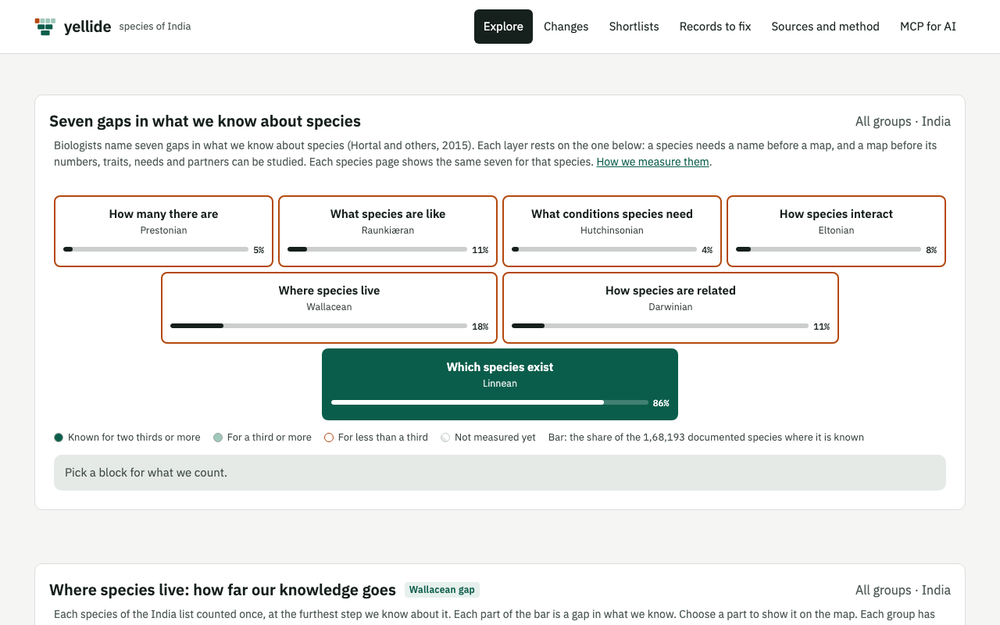
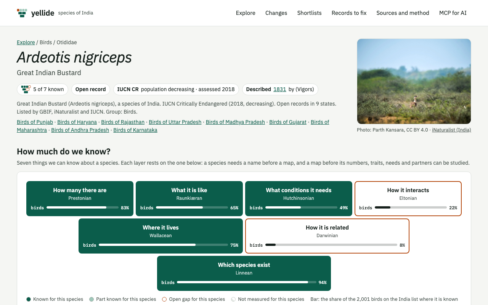
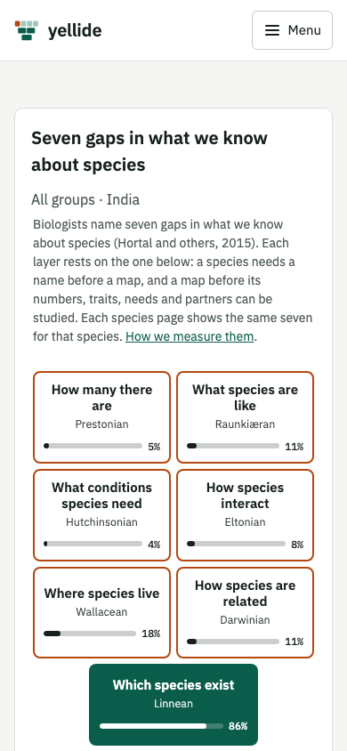

# yellide

**Species of India: find species, where they occur, and their conservation status, from open biodiversity data.**

yellide (ಎಲ್ಲಿದೆ, Kannada for "where is it?") is the master list of India's species, and what changes in it each week.
It was called Overlooked until November 2026, when the site moved from overlooked-india.pages.dev to
[yellide.com](https://yellide.com) (11 Nov 2026).

[](LICENSE)
[](https://creativecommons.org/licenses/by/4.0/)
[](https://yellide.com)
[](https://github.com/urbanmorph/overlooked/actions/workflows/checks.yml)
[](https://registry.modelcontextprotocol.io/v0/servers?search=io.github.sathya-sankaran/yellide)
[](https://pages.cloudflare.com)
[](https://glama.ai/mcp/connectors/io.github.sathya-sankaran/yellide)
[](https://mcptry.com/servers/io.github.sathya-sankaran/yellide)
[](https://mcpservers.org/servers/urbanmorph/overlooked)



## Contents

- [What it does](#what-it-does)
- [Features](#features)
- [Use it from an AI assistant (MCP)](#use-it-from-an-ai-assistant-mcp)
- [Data sources and attribution](#data-sources-and-attribution)
- [How it works](#how-it-works)
- [Project layout](#project-layout)
- [Development](#development)
- [Deploy](#deploy)
- [Contributing](#contributing)
- [Licence](#licence)

## What it does

yellide joins the public sources on India's species into one list: GBIF, iNaturalist, the Zoological and Botanical
Surveys of India (checklists and annual discoveries), Kew WCVP, the lichen and bryophyte checklists of India, Plazi,
Catalogue of Life and the IUCN Red List.

For each species, group, state and biogeographic region it shows:

- whether the species has an open record (a specimen, photo or sighting anyone can check online);
- how many observations of it wait for a name;
- its IUCN status.

Species pages add evidence (type specimens, photos, DNA barcodes), interactions (GloBI), population trends (IUCN,
State of India's Birds) and names in Indian languages (Wikidata).

Each week it builds a new dated list from the sources and compares it with the week before. It holds no sightings and
takes no user input; every figure links back to its source. The larger aim is to track the health of India's species
over time. It follows the data story [The Overlooked Species](https://overlooked-species.surge.sh).

## Features

| Page | What it shows |
|---|---|
| [`/`](https://yellide.com/) Explore | Species of India by group and state: the seven gaps in what we know, open records, observations that wait for a name, IUCN status; search by Latin or English name. |
| `/species/<key>/<slug>` | One species, for example [Ardeotis nigriceps](https://yellide.com/species/GCMS/ardeotis-nigriceps): its sources, the seven gaps, its web of partners (GloBI), map by district, records by decade, IUCN status and trend, evidence, photo, names in Indian languages, observations that wait for a name. |
| [`/in`](https://yellide.com/in) | Place pages: `/in/<place>` and `/in/<place>/<group>` ("Birds of Kerala"), with counts, threatened and endemic species, and every species linked. |
| [`/changes`](https://yellide.com/changes) | The totals by week as tiles and a chart, then what moved since last week: IUCN category changed; a first open record in India or in a state; added to or taken off the list. |
| [`/fix`](https://yellide.com/fix) | Records to fix, for data publishers: GBIF records from India with no exact place or no species name, by dataset, state and group. |
| [`/shortlist`](https://yellide.com/shortlist) | Experimental. Observations on iNaturalist that wait for a name, each with a short list of names from a model, for a person to check on iNaturalist. |
| [`/method`](https://yellide.com/method) | Sources, credit, method, health of the sources at the last run, downloads. |
| [`/mcp`](https://yellide.com/mcp) | For people: how to add the MCP server to an AI assistant. For AI assistants: the MCP server itself (same address). |

Other things worth knowing:

- No coordinates are published. The smallest area shown is a district; the MCP server answers only by state or
  biogeographic province.
- Open data: the site reads its files through `/data/<key>` (CORS open). The data layout for people and agents is in
  [/llms.txt](https://yellide.com/llms.txt).
- Species pages are served at their own address with a title, description, canonical address and schema.org Taxon in
  the HTML, so search engines and link previews see them.

<p align="center">
  
  &nbsp;
  
</p>
<p align="center"><sub>Species page photo: Parth Kansara, CC BY 4.0, via iNaturalist.</sub></p>

## Use it from an AI assistant (MCP)

yellide runs a remote [Model Context Protocol](https://modelcontextprotocol.io) server. It is read only, needs no key
and no account, and reads the same weekly list as the site.

- **Endpoint:** `https://yellide.com/mcp` (Streamable HTTP, stateless)
- **MCP Registry:** [`io.github.sathya-sankaran/yellide`](https://registry.modelcontextprotocol.io/v0/servers?search=io.github.sathya-sankaran/yellide) (see [server.json](server.json))
- **Setup for Claude, ChatGPT, Codex, VS Code, Cursor and others:** [yellide.com/mcp](https://yellide.com/mcp)

Claude Code:

```sh
claude mcp add --transport http --scope user yellide https://yellide.com/mcp
```

Codex:

```sh
codex mcp add yellide --url https://yellide.com/mcp
```

Any other client: add a remote (HTTP) server with the URL `https://yellide.com/mcp`.

| Tool | What it does |
|---|---|
| `find_species` | Find species of India by Latin name or English common name ("great indian bustard", "naja", "cobra"). Returns up to 10 species with their key, group, IUCN category and status. |
| `get_species` | One species by its key: sources that list it, open record, states with an open record, WII regions, IUCN category with year, DOI and trend, endemic, year described and authority, family and order, evidence, names in Indian languages, a photo with its credit, and iNaturalist observations that wait for a name. |
| `count_species` | How many species: documented, with an open record, threatened (IUCN CR, EN, VU), recorded in the last 10 years, endemic, and per IUCN category. Optional filters combine: "threatened birds in Kerala", "endemic frogs of the Western Ghats". |
| `list_species` | List species with the same filters: "snakes of the Western Ghats", "birds of Goa recorded since 2020". Up to 100 rows per page, with the total and a cursor for the next page. |
| `new_species` | Species described from India since a year (2007 or later), from Plazi, BSI Plant Discoveries and ZSI Animal Discoveries: year, group, state of the type locality, journal and a link to the paper, and whether it has been recorded since. |

Filters for `count_species` and `list_species`: `group`, `state`, `region` (WII biogeographic zone or province),
`iucn`, `endemic`, `order`, `suborder`, `family`, `open_record`, `recorded_since`, `described_since`. The server also
offers the resources `yellide://about`, `yellide://groups`, `yellide://states` and `yellide://regions`.

Try it without an assistant:

```sh
curl -s https://yellide.com/mcp \
  -H 'content-type: application/json' \
  -d '{"jsonrpc":"2.0","id":2,"method":"tools/call","params":{"name":"count_species",
       "arguments":{"region":"Western Ghats","iucn":["threatened"]}}}'
```

## Data sources and attribution

yellide reads these sources. Each keeps its own licence and is credited on the site, next to the figures that use it
and in the footer.

| Source | Used for | Licence or terms |
|---|---|---|
| [GBIF.org](https://www.gbif.org) | Occurrence records from India (four SQL downloads a week, each with its own DOI, cited on the site); name matching | GBIF terms; each dataset keeps its licence |
| [Catalogue of Life](https://www.catalogueoflife.org) (ChecklistBank) | Names, classification, year described | CC BY 4.0 |
| [Royal Botanic Gardens, Kew (WCVP)](https://sftp.kew.org/pub/data-repositories/WCVP/) | Plant names and year described | CC BY 4.0 |
| [iNaturalist](https://www.inaturalist.org) | Species per state, research grade and needs ID; photos | Each photo keeps its own Creative Commons licence, credited under it |
| [Plazi](https://plazi.org) | New species described from India | CC0 |
| Botanical Survey of India | National checklists, Plant Discoveries, Indian Virtual Herbarium | Reproduced with acknowledgement under BSI's web policy |
| Zoological Survey of India | Animal Discoveries | Reproduced with acknowledgement under ZSI's website policy |
| Lichen checklist of India | Names, endemic mark, states (counts only) | Sinha, Nayaka and Mishra (2024), doi:10.21756/cab.v8i2.01, CC BY-NC 4.0 |
| Bryophyte checklist of India | Names (counts only) | Dandotiya et al. (2011), Archive for Bryology 88: 1-126; no open licence, cleared for this use |
| [IUCN Red List](https://www.iucnredlist.org) | Category per species (from the GBIF copy, DOI 10.15468/0qnb58) and population trend | IUCN (2026). The IUCN Red List of Threatened Species. Version 2026-1. Accessed via GBIF.org |
| [GloBI](https://www.globalbioticinteractions.org) | Interaction partners (counts and partner names, never rows) | Cite Poelen, Simons and Mungall (2014); each dataset keeps its licence |
| [BOLD Systems](https://boldsystems.org) | Species with a DNA barcode from India (counts) | Credited |
| [Wikidata](https://www.wikidata.org) and Wikimedia Commons | Names in Indian languages; photos | Wikidata CC0; each Commons photo keeps its licence, credited under it |
| [State of India's Birds](https://github.com/stateofindiasbirds) | Bird population trends | MIT; doi:10.5281/zenodo.11124589 |
| Bibliography of South Asian Ornithology | Papers per bird (counts and years, never the records) | Compiled by Aasheesh Pittie; no licence stated; counts published with credit, with approval |
| Local Government Directory and Wildlife Institute of India biogeographic zones, via [bharatlas](https://bharatlas.com) | Districts; 10 zones and 26 provinces (Rodgers, Panwar and Mathur) | LGD CC0-1.0 / CC BY 4.0; WII zones GODL-India |

Limits, terms and how each source is used: [docs/sources.md](docs/sources.md).

## How it works

```
GitHub Actions (weekly / daily)                      R2 overlooked-data          Cloudflare Pages
  request.yml + build.yml  -> GBIF snapshot      ->   snapshots/<week>/      \
  inat.yml                 -> iNaturalist layer  ->   layers/inat/<week>/     |
  newspecies.yml           -> new-species layer  ->   layers/newspecies/<week>/  -> master.yml -> layers/master/<week>/ -> /data/*, /mcp -> pages, agents
  globi.yml, iucn.yml      -> GloBI, IUCN trends ->   cache/ (internal)      /
  (BSI, ZSI, Kew, CoL, IUCN, lichens, bryophytes, BOLD, Wikidata, SoIB, Zotero read by master.py)
This machine (India)
  experiments/corpus_v0    -> shortlists (model, corpus, photos stay here) -> layers/shortlist/<run>/ (JSON only)
```

- **Pipeline (Python, `pipeline/`).** GitHub Actions run the weekly GBIF snapshot and the daily layers, and write
  everything to Cloudflare R2. `pipeline/master.py` (`master.yml`, daily) joins the newest snapshot and layers with
  the other sources into `layers/master/<week>/<build>/`, plus the change feed and the MCP index. A build never
  changes once written; `<week>/current.json` and `latest.json` are written last, so the site reads one build or the
  other, never a mix.
- **Site (`site/`).** Static HTML and JavaScript on Cloudflare Pages.
- **Pages Functions (`functions/`).** `/data/<key>` streams files from R2. `/mcp` is the MCP server. `/species/...`
  and `/in/...` render species and place pages with their metadata. `/sitemaps/*` serves the species and place
  sitemaps.
- **D1.** `functions/_middleware.js` keeps aggregate daily counts in D1: no IP, no cookies, no per-user rows
  ([docs/metrics.md](docs/metrics.md)).
- **Shortlists** are made on a machine in India, not on GitHub Actions: the corpus, image features and model stay
  there; only JSON rows go to R2 ([docs/shortlist_data.md](docs/shortlist_data.md)).

A week is named by its Monday in UTC (`2026-10-26`). Lists before 27 October 2026 were monthly (`2026-10`).

<details>
<summary>Workflows, steps of a snapshot, and why it is safe to run again</summary>

### Workflows

| Workflow | When (UTC) | What it does |
|---|---|---|
| `request.yml` | 02:17 on Mondays, and by hand | Checks every source. Sends the first GBIF download request. Commits the run state to `runs/<week>.json`. |
| `build.yml` | Every 6 hours, Monday to Thursday (at :47), and by hand | Sends the next GBIF download when the last one is ready. When all are ready: builds, checks and publishes the snapshot to R2. |
| `inat.yml` | 05:23 daily, and by hand | iNaturalist layer: species per state, research grade and needs ID (about 1,400 requests a week, under 9,000 a day). |
| `newspecies.yml` | 06:41 daily, and by hand | New-species layer: names from Plazi, BSI Plant Discoveries and ZSI Animal Discoveries, two GBIF downloads, matching. |
| `master.yml` | 10:37 daily, and by hand | Master list, the change feed and the MCP index. Does nothing when no input changed. |
| `globi.yml` | 04:41 on Wednesdays, and by hand | GloBI interactions, only when GloBI's snapshot changed. |
| `iucn.yml` | 03:29 on the 3rd of each month, and by hand | IUCN Red List API: the population trend of each assessed species (needs `IUCN_TOKEN`). |
| `checks.yml` | Every push to `main` and every pull request | Runs the tests. |

Scheduled runs need the repository variable `PIPELINE_ENABLED=true`. Runs started by hand always work. A failed run
comments on the open "<workflow> failed" issue, or opens one (`scripts/report_failure.sh`).

Master list retention: this week keeps its current build and the one before; a past week keeps only its last build;
GBIF snapshots are kept.

### Steps of a snapshot

1. **Check the sources.** One request to each source (`pipeline/health.py`). If GBIF or R2 does not answer, the run
   stops and opens an issue. If another source does not answer, that source keeps the data of the last run.
2. **Download.** Four GBIF SQL downloads, one after another, each with its own DOI:
   - A, `ledger_cube`: species at each point (coordinates rounded to 3 decimals), first and latest year, records.
   - C, `species_history`: names, classification, and records by decade and kind of record.
   - U, `unresolved_cube`: records named only to genus, family or higher, with the genus.
   - L, `unlocated_cube`: records with no coordinates, by taxon, state as written, dataset and kind of record.
3. **Place.** Each point goes to its LGD district and to its WII biogeographic province. A point less than 5 km from
   land goes to the nearest district; a point farther out is offshore. A record with no coordinates goes to a state
   when its state text names one (old names too, such as Orissa). If not, it has no place.
4. **Compute.** The ledger, the page data (small JSON files per area), the species files, the records with no species
   name, `unlocated.json`, and the change feed against the previous snapshot.
5. **Check.** Every download has a DOI; the ledger is not empty; species and ledger rows did not change by more than
   20% from the last run. Records with no coordinates are not empty, and did not change by more than 20% if the last
   run has them.
6. **Publish.** Files go to R2 under `snapshots/<week>/`, the manifest last, then `latest.json`.

### Safe to run again

- A finished step is not done again. Download keys and downloaded files are reused.
- A build is skipped if a snapshot from the same inputs (download keys and boundary checksum) exists.
- R2 uploads skip files that are already there with the same SHA-256, so a stopped upload continues.
- A published snapshot never changes. Files derived later are added as new files only (`scripts/backfill_derived.py`).
- If GBIF reports no India record added, changed or re-processed since the last published run, the week downloads
  nothing.

</details>

## Project layout

```
pipeline/        Python pipeline: sources, GBIF downloads, master list, change feed, MCP index, R2 upload
functions/       Cloudflare Pages Functions: /data, /mcp, /species, /in, /sitemaps, /go, metrics middleware
  lib/           Shared code: mcp.js (the MCP server), species_page.js, place_page.js, metrics.js
site/            The static site served by Cloudflare Pages (HTML, assets, llms.txt, robots.txt, _routes.json)
site-parts/      Shared header, footer and head, copied into site/ by scripts/pages.py
migrations/      D1 schema for the usage counters
scripts/         Local server, page builder, backfills, failure reporting
tests/           Python tests (test_*.py) and Node tests (*.test.mjs)
.github/         Workflows and the issue template
runs/            Run state of each weekly snapshot (committed by request.yml)
experiments/     Shortlist corpus and model work (needs its own environment)
docs/            Sources, metrics, plan, progress, shortlist data contract, screenshots
server.json      The MCP Registry entry
PDGI.md          How the project follows People's Digital Goods and Infrastructure principles
```

## Development

Needs Python 3.11 or later (CI uses 3.12) and Node 22.

```sh
git clone https://github.com/urbanmorph/overlooked.git
cd overlooked
python3 -m venv .venv && .venv/bin/pip install -e ".[dev]"
```

Run the checks (the same as `checks.yml`):

```sh
.venv/bin/python -m pyflakes pipeline tests scripts   # lint
.venv/bin/pytest -q                                   # Python tests
node --test tests/*.test.mjs                          # Node tests (functions and site scripts)
```

Work on the site:

```sh
.venv/bin/python scripts/serve.py    # the site at http://127.0.0.1:8790/
.venv/bin/python scripts/pages.py    # after editing site-parts/ or site/assets/: shared parts, and ?v= versions on every script and stylesheet
```

Run the pipeline:

```sh
.venv/bin/python -m pipeline.health                       # check every source
.venv/bin/python -m pipeline.run request --state Kerala   # a test run for one state (never published)
.venv/bin/python -m pipeline.run build --run-id <week>-kerala
```

Secrets go in `.env` (never committed): `GBIF_USER`, `GBIF_PASSWORD`, `GBIF_EMAIL`, `R2_ACCESS_KEY_ID`,
`R2_SECRET_ACCESS_KEY`, `R2_ENDPOINT`, `R2_BUCKET`, `IUCN_TOKEN`. GitHub Actions has the same names as repository
secrets. The tests need none of them.

## Deploy

The site deploys through Cloudflare Pages' git integration: a push to `main` builds and publishes `site/` with the
Functions in `functions/`. The Functions read R2 (the `overlooked-data` bucket, binding `DATA`) and D1 (the `DB` binding, optional;
without it nothing is counted). Data is not part of the deploy: the GitHub Actions workflows publish it to R2, and the
site reads it through `/data/*`. Only the small pointer `site/data/latest.json` is committed, by `build.yml` after it
publishes a snapshot, and that commit starts a Pages build.

## Contributing

Issues and pull requests are welcome at [github.com/urbanmorph/overlooked](https://github.com/urbanmorph/overlooked).

- Run the checks above before opening a pull request; `checks.yml` runs them on every pull request.
- If you edit `site-parts/` or `site/assets/`, run `scripts/pages.py` and commit the result.
- A new source needs its limits and terms recorded in [docs/sources.md](docs/sources.md) and its credit on the site.
- If showing a species by district puts it at risk, use the
  [sensitive species location](https://github.com/urbanmorph/overlooked/issues/new?template=sensitive-species.yml)
  issue form. Do not write any location in it.

Plan and decisions: [docs/plan.md](docs/plan.md). Progress: [docs/progress.md](docs/progress.md). Usage counts:
[docs/metrics.md](docs/metrics.md). How the project follows PDGI: [PDGI.md](PDGI.md).

## Licence

- Code: [MIT](LICENSE), Sathya Sankaran.
- Data and text on the site: [CC BY 4.0](https://creativecommons.org/licenses/by/4.0/), Sathya Sankaran.
- Each source keeps its own licence and is credited on the site.
